# AI-Generated Image Detection for Etsy Product Listings

A team project that classifies Etsy product images as authentic or AI-generated.

## Results

| Model | F1 | Evaluation note |
|---|---:|---|
| Frequency-feature classifier | 0.9145 | Train F1, in-sample |
| Ensemble | 0.9250 | Out-of-fold F1 at threshold 0.5 |
| Ensemble | 0.9270 | Out-of-fold F1 at threshold 0.576 |

The ensemble results are out-of-fold. Its weights were tuned on the same folds.



## Team contributions

This project was completed by a team of two with Rahul Satheesan Nair. Rahul built the EfficientNet-B4 and ViT pipelines and the frequency-feature classifier. I built the ConvNeXt-Base model, multi-scale test-time augmentation, ensemble calibration and weighting, threshold tuning, and final integration.

## Methods

The notebook uses five-fold stratified cross-validation, transfer learning, MixUp and CutMix, temperature scaling, test-time augmentation, ensemble weight optimization, and threshold tuning.

## Run

The notebook was developed for Kaggle. It expects the image dataset, CSV files, and pretrained weights at Kaggle input paths defined in the notebook. Those files are not in this repository, so a clean clone alone cannot run the training workflow.

In the Kaggle notebook environment, attach the required datasets and weights, then install the listed packages and run the notebook cells in order:

```sh
python -m pip install -r requirements.txt
jupyter notebook Etsy_Final.ipynb
```

## Topics

computer-vision, image-classification, deep-learning, pytorch, ensemble-learning, etsy
